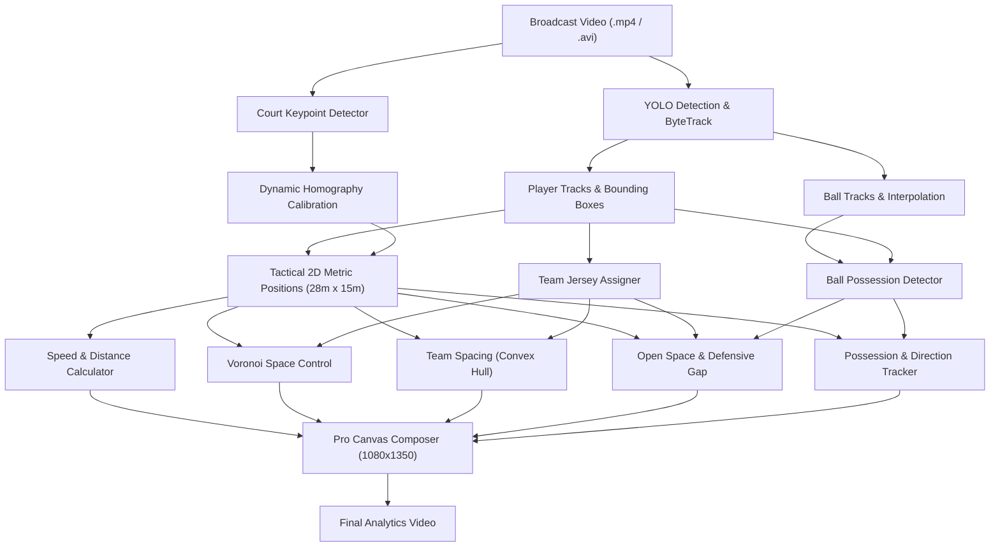

# CourtVision Pro — Basketball AI Analytics & Tactical Vision

[](https://www.python.org/downloads/)
[](https://github.com/ultralytics/ultralytics)
[](https://opencv.org/)

**CourtVision Pro** is an end-to-end computer vision and spatial analytics pipeline that converts broadcast basketball video into professional NBA-grade tactical analytics (1080×1350 portrait format).

By combining deep learning object detection, ByteTrack tracking, dynamic camera calibration, homography court transformation, and computational geometry, CourtVision Pro overcomes the challenges of broadcast pan, tilt, zoom, and player occlusions to extract measurable game statistics.

---

## 🏀 The Challenge vs The Solution

### The Challenge
Tracking players in broadcast basketball footage is difficult because:
- **Dynamic Camera Motion**: Cameras pan, tilt, and zoom across the court constantly.
- **Occlusions & Crowding**: Players cross paths and cluster together in the paint.
- **Distractions**: Referees, bench players, and courtside fans enter the frame.
- **Perspective Distortion**: Monocular broadcast cameras distort metric distances, speeds, and team spacing.

### The Solution
1. **Player & Ball Tracking**: YOLO object detection paired with ByteTrack to track player identities and the basketball continuously.
2. **Team Identification**: Vision-based jersey classification to cluster players into opposing teams while filtering out referees.
3. **Dynamic Court Calibration**: Court landmark detection computing per-frame homography matrices to map camera pixels directly to real-world metric coordinates ($28\text{m} \times 15\text{m}$).
4. **Voronoi Space Control**: Computational geometry partitioning the court into spatial control zones per team and measuring frontcourt dominance.
5. **Team Spacing & Open Space**: Convex hull area ($m^2$) for offensive and defensive width, alongside average defensive gap distance to nearest defenders.
6. **NBA Broadcast Graphics**: Composited 1080×1350 portrait presentation with wireframe player poses, speed badges, tactical court mapping, live attacking status, and end-of-possession recaps.

---

## 🚀 Key Features

### 1. Professional Broadcast Composite (1080×1350 Portrait)
- **Header Banner**: Dark broadcast aesthetic with dynamic team legend capsules (`PHI 76ERS` vs `IND PACERS`).
- **Enhanced Broadcast Video**: Sits in the upper section with live visual analytics overlays.
- **Section Divider**: Displays `LIVE TACTICAL VIEW` alongside an automatic live attacking team & direction pill (`IND ATTACKING ←`).
- **Full-Court Tactical View**: Dark navy regulation 2D court with real-time Voronoi control regions and player dots.
- **4-Card Analytics Dashboard**: Styled stat cards showing real-time spatial analytics.

### 2. Player Overlays & Pose Analytics
- **Skeleton Wireframes**: Clean anatomical limb lines and white circular joint nodes rendered directly on players.
- **Team-Colored Speed Badges**: Floating pills above players displaying real-world running speed (e.g. `13 km/h`), with outlier suppression to filter tracking identity jumps.
- **Court Foot Rings**: Elliptical base rings on the court surface indicating foot contact position.
- **Ball Possession Rings**: Pulsing rings around the ball handler.

### 3. Advanced Spatial Analytics
- **Voronoi Space Control**: Bounded Voronoi diagrams partition the court into team control territories (slate-blue vs warm-gold), calculating the exact percentage of frontcourt controlled.
- **Team Spacing (Convex Hull $m^2$)**: Real-time convex hull surface area tracking how compressed or spread out each team is.
- **Offensive Open Space**: Measures the average separation distance in metres between each offensive player and their nearest defender.
- **Cumulative Distance**: Real-time meters covered per player and team throughout the possession.

### 4. Possession Recap Screen
- At the end of each possession or clip, an automated dark overlay summarizes:
  - Total possessions tracked and duration
  - Team distance covered in metres
  - Top sprint speed (km/h) and fastest player/team
  - Offensive frontcourt space control percentage
  - Average offensive open space gap

---

## 📊 Pipeline Architecture



---

## 📁 Project Structure

```text
CourtVision/
├── analytics/                           # Advanced spatial analytics
│   ├── __init__.py
│   ├── open_space.py                   # Average gap to nearest defender
│   ├── possession_tracker.py           # Possession & direction tracking + recap
│   ├── team_spacing.py                 # Convex hull spacing in m²
│   └── voronoi_space_control.py        # Voronoi space control partitioning
├── configs/                            # Configuration constants & team defaults
│   ├── __init__.py
│   └── configs.py
├── court_keypoint_detector/            # Keypoint detection on court lines
│   ├── __init__.py
│   └── court_keypoint_detector.py
├── drawers/                            # Video rendering and overlay drawers
│   ├── __init__.py
│   ├── ball_tracks_drawer.py
│   ├── court_key_points_drawer.py
│   ├── frame_number_drawer.py
│   ├── pass_and_interceptions_drawer.py
│   ├── player_tracks_drawer.py
│   ├── possession_recap_drawer.py      # Summary recap screen
│   ├── pro_canvas_composer.py          # 1080x1350 layout compositor
│   ├── pro_overlay_drawer.py           # Skeleton wireframe & speed badges
│   ├── pro_tactical_drawer.py          # Dark full-court Voronoi drawer
│   ├── speed_and_distance_drawer.py
│   ├── stats_dashboard_drawer.py       # 4-card bottom stats dashboard
│   ├── tactical_view_drawer.py
│   ├── team_ball_control_drawer.py
│   └── utils.py                        # Rounded rectangles, ellipses, triangles
├── images/                             # Court reference graphics
├── models/                             # Pretrained detector weights (.pt)
│   ├── ball_detector_model.pt
│   ├── court_keypoint_detector.pt
│   └── player_detector.pt
├── pass_and_interception_detector/     # Pass detection logic
├── speed_and_distance_calculator/      # Metric distance & velocity estimation
├── tactical_view_converter/            # Homography matrix transformation
├── team_assigner/                      # Jersey color classification
├── trackers/                           # YOLO + ByteTrack trackers
│   ├── ball_tracker.py
│   └── player_tracker.py
├── utils/                              # Video I/O and caching utilities
├── main.py                             # Main pipeline entry point
├── requirements.txt                    # Python dependencies
└── Dockerfile                          # Containerized environment
```

---

## 🛠️ Installation & Setup

### Prerequisites
- Python 3.9, 3.10, 3.11, or 3.12
- macOS, Linux, or Windows
- FFmpeg (for video encoding/decoding)

### 1. Clone the Repository
```bash
git clone https://github.com/Swayam2932/CourtVision.git
cd CourtVision
```

### 2. Set Up Virtual Environment
```bash
python3 -m venv nba
source nba/bin/activate
pip install --upgrade pip
pip install -r requirements.txt
```

### 3. Download Model Weights
Download the pre-trained weights from the [CourtVision Model Weights Folder](https://drive.google.com/drive/folders/1GfzD-WVNPAB4aDNuNdy90bXJgHVy3NOH?usp=sharing) and place them in the `models/` directory:
```text
models/
├── player_detector.pt
├── ball_detector_model.pt
└── court_keypoint_detector.pt
```

---

## 🎬 Running the Pipeline

### 1. Professional Mode (Default - 1080×1350 Portrait)
Process any basketball video to produce the full broadcast analytics layout:
```bash
python main.py input_videos/game.mp4 --output_video output_videos/game_analytics.mp4
```

### 2. Custom Team Names
Specify custom team names for the legend, attacking pill, and recap screens:
```bash
python main.py input_videos/game.mp4 \
  --team1 "BOS CELTICS" \
  --team2 "GSW WARRIORS" \
  --output_video output_videos/finals_game.mp4
```

### 3. Legacy Mode (720p Landscape)
To generate the original 720p landscape video with classic player circles and keypoints:
```bash
python main.py input_videos/game.mp4 --legacy --output_video output_videos/legacy_output.avi
```

### CLI Arguments Reference

| Argument | Type | Default | Description |
| :--- | :--- | :--- | :--- |
| `input_video` | Positional | *Required* | Path to source video file |
| `--output_video` | String | `output_videos/pro_output_video.mp4` | Path for the annotated video |
| `--stub_path` | String | `stubs` | Directory for caching tracking stubs |
| `--team1` | String | `"PHI 76ERS"` | Display name for Team 1 |
| `--team2` | String | `"IND PACERS"` | Display name for Team 2 |
| `--legacy` | Flag | `False` | Run original 720p landscape layout |

---

## 🐳 Docker Support

Build the Docker image:
```bash
docker build -t courtvision .
```

Run with your local model weights and video directories mounted:
```bash
docker run --rm \
  -v "$PWD/models:/app/models" \
  -v "$PWD/input_videos:/app/input_videos" \
  -v "$PWD/output_videos:/app/output_videos" \
  courtvision input_videos/game.mp4 --output_video output_videos/game_analytics.mp4
```

---

## ⚡ Caching with Stubs

To accelerate development and prevent re-running heavy neural networks across iterations, the pipeline automatically caches intermediate outputs in `stubs/`:
- `player_track_stubs.pkl`: Player bounding boxes and track IDs
- `ball_track_stubs.pkl`: Basketball detections across frames
- `court_key_points_stub.pkl`: Court landmark keypoints
- `player_assignment_stub.pkl`: Team classifications

If stub files matching the input video's frame count are found in `stubs/`, the model inference phase is skipped and cached results are used immediately.

